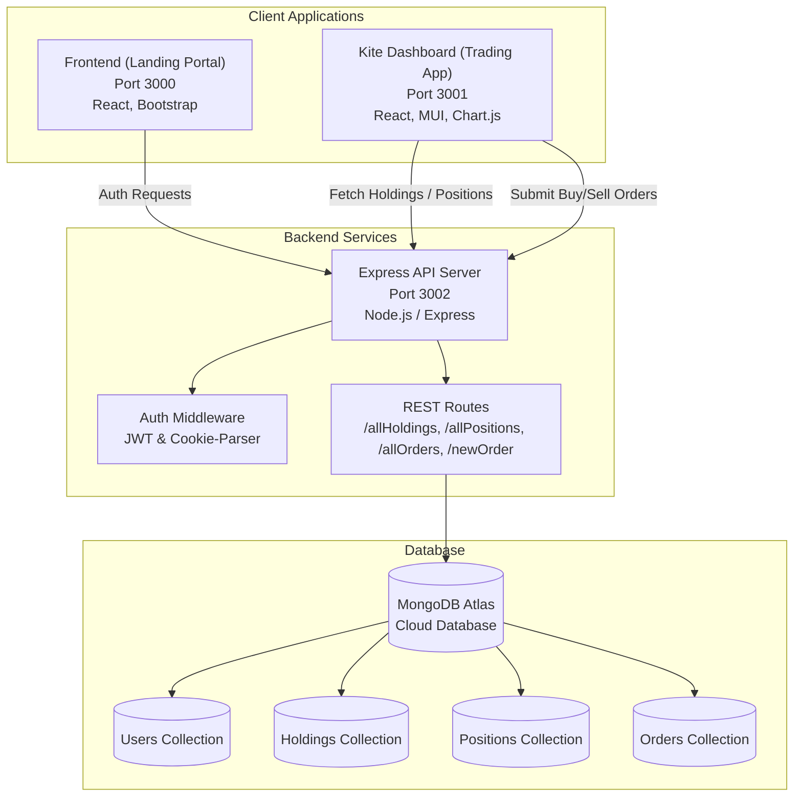

<div align="center">

# 📈 Zerodha (Kite) Full-Stack Clone

An end-to-end investment and trading platform replica inspired by **Zerodha** and **Kite**. Built using the **MERN Stack** (MongoDB, Express.js, React.js, Node.js) with Material UI, Chart.js, and JWT-based authentication.

[](#)
[](#)
[](#)
[](#)
[](#)
[](#)
[](#)

[Features](#-key-features) • [Architecture](#-architecture) • [Tech Stack](#-tech-stack) • [Project Structure](#-project-structure) • [Getting Started](#-getting-started) • [API Reference](#-api-endpoints) • [Database Schemas](#-database-schemas)

</div>

---

## 📌 Overview

This project is a modular, production-ready clone of **Zerodha**, India's largest discount stock brokerage firm. It replicates both user-facing interfaces:

1. **Zerodha Landing & Marketing Portal (`frontend`)**: Clean, responsive brand showcase with detailed product overviews, transparent pricing calculators, support ticket workflows, and company details.
2. **Kite Trading Dashboard (`dashboard`)**: Interactive trader workspace featuring real-time watchlist feeds, Chart.js portfolio analytics, a draggable buy/sell order modal, holdings ledger, open positions, and fund balances.
3. **Backend Engine (`backend`)**: Robust REST API handling authentication (JWT + HTTP cookies + bcrypt), MongoDB database transactions, order processing, and portfolio synchronization.

---

## 🏗️ Architecture



---

## ✨ Key Features

### 🌐 1. Public Landing Portal (`frontend`)
- **Home & Brand Story**: Hero section, corporate achievements, ecosystem statistics, and customer education highlights.
- **Product Ecosystem**: Dedicated showcases for Zerodha products (Kite, Console, Coin, Kite Connect, Varsity).
- **Transparent Pricing**: Detailed breakdown of free equity delivery trades, flat ₹20 intraday and F&O brokerage fees.
- **Customer Support Portal**: Knowledge base categories and ticket creation interface.
- **Account Onboarding**: Gateway for user registration and authentication.

### 📊 2. Kite Trading Dashboard (`dashboard`)
- **Interactive Stock Watchlist**: Track stocks (INFY, TCS, RELIANCE, HDFCBANK, etc.) with real-time price updates, % gain/loss badges, and quick-action tooltips.
- **Draggable Buy/Sell Modal**: Order placement window specifying quantity, target price, order types, and automatic required margin estimation.
- **Holdings Management**: Comprehensive portfolio table detailing quantity, average cost, LTP (Last Traded Price), current value, P&L, and net changes.
- **Visual Analytics**:
  - **Portfolio Distribution**: Doughnut charts displaying stock allocation across instruments.
  - **Stock Price Comparison**: Vertical bar charts comparing asset values.
- **Positions Tracker**: Intraday and overnight open positions monitor (CNC/MIS).
- **Orders Ledger**: Real-time record of all placed buy/sell orders.
- **Funds & Margins View**: Instant snapshot of available trading cash, used margins, and collateral.

### 🛡️ 3. Backend & Security (`backend`)
- **Authentication & Authorization**: Secure signup and login powered by `bcryptjs` password hashing and signed JSON Web Tokens (`jwt`).
- **Cookie-Based Sessions**: Automated token storage via HTTP cookies with cross-origin support (`cors` enabled).
- **Mongoose Data Modeling**: Strongly-typed schemas for users, stock holdings, positions, and trades.
- **Extensible REST Architecture**: Clean controller-route structure ready for market data websocket integration.

---

## 🛠️ Tech Stack

| Domain | Technology / Library | Description |
| :--- | :--- | :--- |
| **Frontend UI** | React.js, React Router v7, Bootstrap 5 | Public web portal and marketing site |
| **Trading Dashboard** | React.js, React Router v6, Material-UI (MUI), Chart.js, React-ChartJS-2 | High-performance trading workspace |
| **Backend API** | Node.js, Express.js (v5) | RESTful API server |
| **Database** | MongoDB Atlas, Mongoose ODM (v8) | Cloud NoSQL document database |
| **Authentication** | JSON Web Tokens (`jsonwebtoken`), `bcryptjs`, `cookie-parser` | Token-based security and password encryption |
| **HTTP Client** | Axios | Asynchronous API communication |
| **Environment** | Dotenv, Nodemon | Dev tooling and environment isolation |

---

## 📂 Project Structure

```text
Zerodha-Clone/
├── backend/                    # Express REST API Server
│   ├── controllers/            # Route controllers (AuthController, etc.)
│   │   └── AuthController.js
│   ├── model/                  # Mongoose models
│   │   ├── HoldingsModel.js
│   │   ├── OrdersModel.js
│   │   ├── PositionsModel.js
│   │   └── UsersModel.js
│   ├── routes/                 # Express API routes
│   │   └── AuthRoute.js
│   ├── schemas/                # Mongoose database schemas
│   │   ├── HoldingsSchema.js
│   │   ├── OrdersSchema.js
│   │   └── PositionsSchema.js
│   ├── utils/                  # Utility functions (SecretToken generator)
│   │   └── SecretToken.js
│   ├── .env.example            # Environment variables template
│   ├── index.js                # Main server entry point
│   └── package.json
│
├── dashboard/                  # Kite Trading Web Application
│   ├── public/                 # Static assets & HTML template
│   ├── src/
│   │   ├── components/         # React dashboard widgets & pages
│   │   │   ├── Apps.js         # Partner integration apps
│   │   │   ├── BuyActionWindow.js # Order execution popup modal
│   │   │   ├── Dashboard.js    # Dashboard router wrapper
│   │   │   ├── DoughnoutChart.js # Stock distribution doughnut chart
│   │   │   ├── Funds.js        # Margin and cash balances
│   │   │   ├── GeneralContext.js # React Context for modal states
│   │   │   ├── Holdings.js     # Stock holdings portfolio table
│   │   │   ├── Home.js         # TopBar & Layout container
│   │   │   ├── Menu.js         # Navigation menu
│   │   │   ├── Orders.js       # Placed order logs
│   │   │   ├── Positions.js    # Open trading positions
│   │   │   ├── Summary.js      # Account equity & balance summary
│   │   │   ├── TopBar.js       # Header ticker & indices (NIFTY/SENSEX)
│   │   │   ├── VerticalGraph.js# Price distribution bar chart
│   │   │   └── WatchList.js    # Live stock market watchlist
│   │   ├── data/
│   │   │   └── data.js         # Watchlist mock feed & defaults
│   │   ├── index.js            # Dashboard root entry
│   │   └── index.css           # Trading platform stylesheet
│   └── package.json
│
├── frontend/                   # Zerodha Marketing & Landing Portal
│   ├── public/
│   │   └── media/images/       # High-resolution logos, badges, and icons
│   ├── src/
│   │   ├── landing_page/
│   │   │   ├── about/          # About Us & leadership team
│   │   │   ├── home/           # Landing page sections (Hero, Awards, Pricing, Stats)
│   │   │   ├── pricing/        # Brokerage calculators & pricing cards
│   │   │   ├── products/       # Product ecosystem (Kite, Coin, Console)
│   │   │   ├── signup/         # User registration form
│   │   │   ├── support/        # Help center and ticket submission
│   │   │   ├── Footer.js       # Global footer
│   │   │   ├── Navbar.js       # Global header navigation
│   │   │   └── NotFound.js     # 404 handler
│   │   ├── index.js            # App routing & entry point
│   │   └── index.css
│   └── package.json
│
├── .gitignore                  # Git ignore rules for node_modules, build & .env
└── README.md                   # Comprehensive project documentation
```

---

## 🚀 Getting Started

Follow these instructions to set up the project locally on your system.

### Prerequisites

Ensure you have the following installed:
- [Node.js](https://nodejs.org/) (`v18.x` or higher recommended)
- [npm](https://www.npmjs.com/) (bundled with Node) or `yarn`
- [MongoDB Atlas](https://www.mongodb.com/atlas) account or a local MongoDB database instance

---

### Step 1: Clone the Repository

```bash
git clone https://github.com/Shubham-Parsana/Zerodha-Clone.git
cd Zerodha-Clone
```

---

### Step 2: Configure and Run Backend

1. Navigate to the `backend` directory:
   ```bash
   cd backend
   ```

2. Install dependencies:
   ```bash
   npm install
   ```

3. Configure environment variables:
   Create a `.env` file in the `backend/` folder (refer to `.env.example`):
   ```env
   PORT=3002
   MONGO_URL=your_mongodb_connection_string_here
   TOKEN_KEY=your_jwt_secret_key_here
   ```

4. Start the backend development server:
   ```bash
   npm start
   ```
   *The server will start at `http://localhost:3002`.*

---

### Step 3: Run the Landing Portal (`frontend`)

1. Open a new terminal and navigate to the `frontend` directory:
   ```bash
   cd frontend
   ```

2. Install dependencies:
   ```bash
   npm install
   ```

3. Launch the React development server:
   ```bash
   npm start
   ```
   *The landing portal will run at `http://localhost:3000`.*

---

### Step 4: Run the Kite Dashboard (`dashboard`)

1. Open a new terminal and navigate to the `dashboard` directory:
   ```bash
   cd dashboard
   ```

2. Install dependencies:
   ```bash
   npm install
   ```

3. Start the dashboard development server:
   ```bash
   npm start
   ```
   *(If prompted that port 3000 is occupied, press `Y` to automatically run on port 3001, or set `PORT=3001` in your environment).*

---

## 📡 API Endpoints

The backend server exposes the following REST endpoints on port `3002`:

### Authentication
| Method | Endpoint | Description | Request Payload | Response |
| :--- | :--- | :--- | :--- | :--- |
| `POST` | `/signup` | Registers a new user and sets a JWT cookie | `{ username, email, password }` | `{ message, success, user }` |
| `POST` | `/login` | Authenticates user and returns session cookie | `{ email, password }` | `{ message, success }` |

### Portfolio & Orders
| Method | Endpoint | Description | Request Payload | Response |
| :--- | :--- | :--- | :--- | :--- |
| `GET` | `/allHoldings` | Returns list of all equity holdings | *None* | `Array<Holdings>` |
| `GET` | `/allPositions` | Returns open intraday/delivery positions | *None* | `Array<Positions>` |
| `GET` | `/allOrders` | Fetches history of executed orders | *None* | `Array<Orders>` |
| `POST` | `/newOrder` | Executes and stores a new stock order | `{ name, qty, price, type, isDown }` | `201 Created` ("Order created!") |

---

## 🗄️ Database Schemas

### 1. User Schema (`UsersModel`)
```javascript
{
  email: { type: String, required: true, unique: true },
  username: { type: String, required: true },
  password: { type: String, required: true },
  createdAt: { type: Date, default: new Date() }
}
```

### 2. Holdings Schema (`HoldingsSchema`)
```javascript
{
  name: String,      // e.g. "BHARTIARTL", "HDFCBANK"
  qty: Number,       // Number of shares held
  avg: Number,       // Average purchase price
  price: Number,     // Current market price (LTP)
  net: String,       // Net percentage change
  day: String        // Day percentage change
}
```

### 3. Positions Schema (`PositionsSchema`)
```javascript
{
  product: String,   // "CNC" (Cash & Carry) or "MIS" (Margin Intraday)
  name: String,      // e.g. "EVEREADY"
  qty: Number,
  avg: Number,
  price: Number,
  net: String,
  day: String,
  isLoss: Boolean
}
```

### 4. Orders Schema (`OrdersSchema`)
```javascript
{
  name: String,      // Stock ticker symbol
  qty: Number,       // Quantity ordered
  price: Number,     // Limit / Market execution price
  type: String       // "Buy" or "Sell"
}
```

---

## 🧪 Testing

Both client applications come configured with Jest and React Testing Library:

```bash
# Run tests in frontend
cd frontend
npm test

# Run tests in dashboard
cd dashboard
npm test
```

---

## 🗺️ Roadmap & Future Enhancements

- [ ] **Real-Time WebSockets**: Live order book and market ticks via WebSocket/Socket.io.
- [ ] **Interactive Candlestick Charts**: Integrate TradingView charting library.
- [ ] **Payment Gateway Integration**: Mock or Razorpay UPI/Netbanking fund transfers.
- [ ] **Stop-Loss & Limit Orders**: Advanced order bracket configurations (GTT, SL, SL-M).
- [ ] **Dark / Light Theme Switcher**: Full kite-style theme support.

---

## 🤝 Contributing

Contributions, issues, and feature requests are always welcome!

1. Fork the Project
2. Create your Feature Branch (`git checkout -b feature/AmazingFeature`)
3. Commit your Changes (`git commit -m 'Add some AmazingFeature'`)
4. Push to the Branch (`git push origin feature/AmazingFeature`)
5. Open a Pull Request

---

## 📄 License

This project is licensed under the [ISC License](LICENSE).

---

## 👤 Author

**Shubham Parsana**
- GitHub: [@Shubham-Parsana](https://github.com/Shubham-Parsana)
- Repository: [Zerodha-Clone](https://github.com/Shubham-Parsana/Zerodha-Clone.git)

---

<div align="center">
  <sub>Built with ❤️ as an educational fullstack financial engineering project.</sub>
</div>
